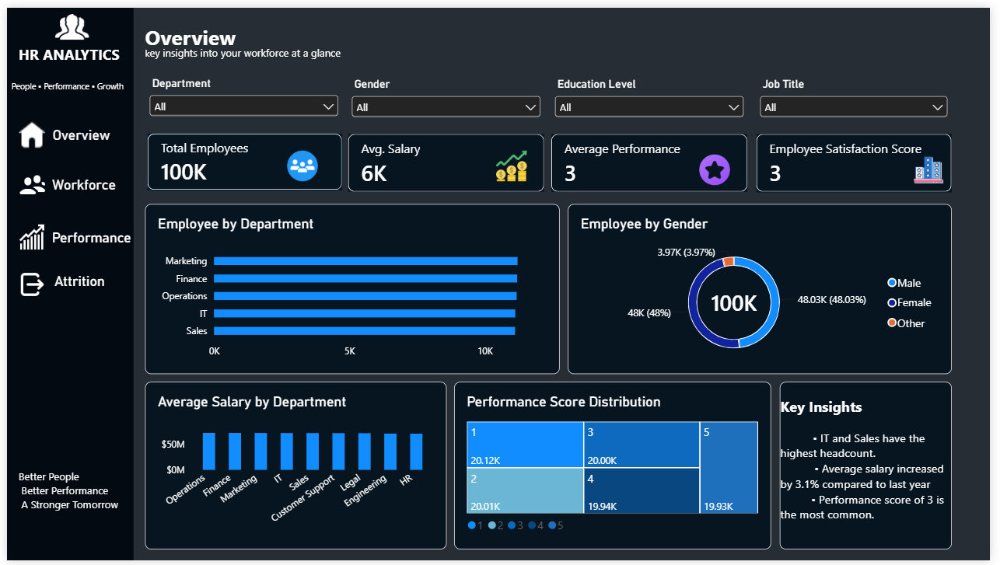
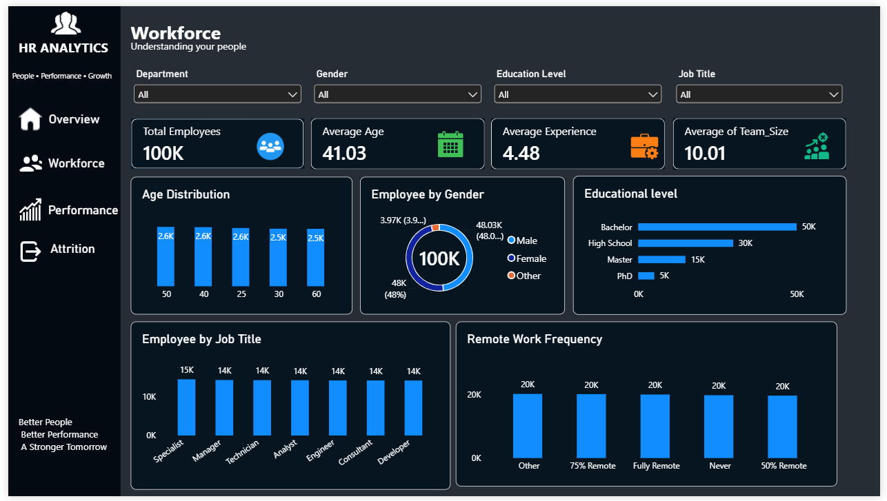
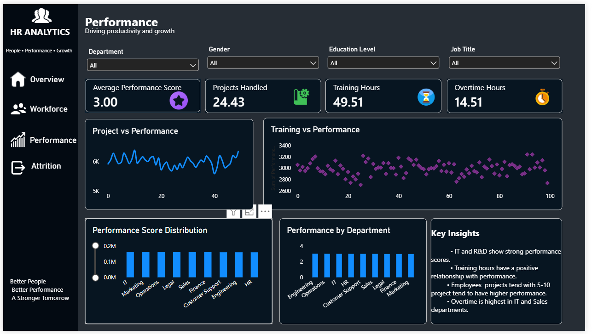
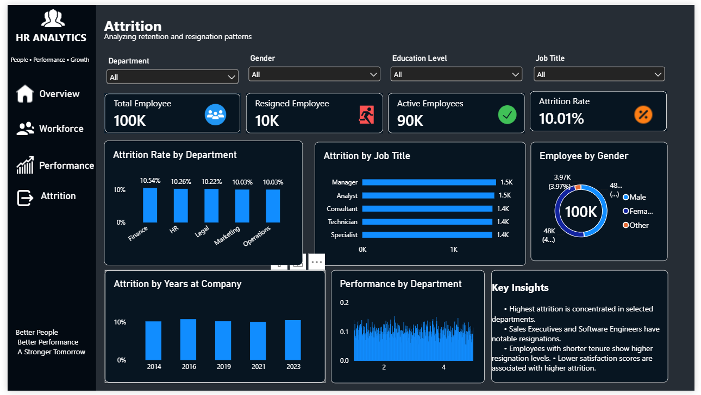

# HR Analytics Dashboard | Power BI

## Project Overview
An interactive HR Analytics dashboard built using Power BI to analyze workforce data and provide insights into employee demographics, performance, workforce distribution, and attrition.

## Dashboard Pages

- **Overview:** Employee headcount, average salary, performance, satisfaction, department and gender distribution.
- **Workforce:** Age distribution, employee experience, team size, education, job titles, and remote work frequency.
- **Performance:** Performance scores, projects handled, training hours, overtime, and departmental performance.
- **Attrition:** Resigned employees, active workforce, attrition rate, departmental attrition, job titles, and tenure patterns.

## Tools Used
- Power BI
- Power Query
- DAX
- Excel

## Key Features
- Interactive filters for Department, Gender, Education Level, and Job Title
- KPI cards
- Employee demographic analysis
- Performance analysis
- Attrition analysis
- Data visualization and dashboard reporting

## Skills Demonstrated
Data Analysis | Data Visualization | Dashboard Development | Data Cleaning | KPI Analysis | Business Insights

## Dashboard Preview

### Overview

### Workforce

### Performance

### Attrition

